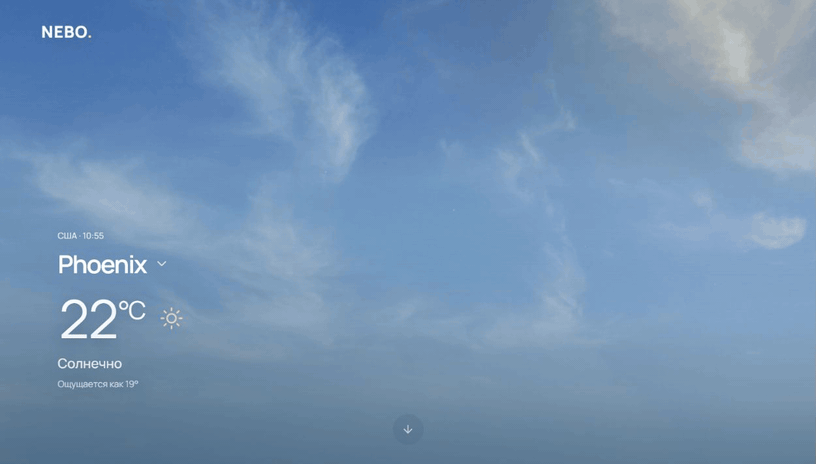

# NEBO — прогноз погоды

Текущая погода, почасовой график и прогноз на три дня. Интерактивное небо меняется вместе с погодой и временем суток в выбранном городе.

[Открыть NEBO](https://weather-app-sage-six-68.vercel.app/) · [Быстрый запуск](#быстрый-запуск) · [English quick start](#english-quick-start)

## Демо

В записи с рабочего сайта: ясное небо в Финиксе, смена города на Астану и переход от дождливого неба к почасовому графику. Погода показана на момент записи.

<details open>
<summary>Демо NEBO · 9 секунд</summary>



</details>

## Возможности

- **Города.** Нажмите на название города, чтобы открыть поиск, выбрать один из предложенных городов или определить своё местоположение.
- **Прогноз.** График температуры на восемь ближайших часов, вероятность осадков и дневные минимумы и максимумы. Температуру можно переключать между °C и °F.
- **Подробности.** Ветер, влажность, давление, восход и закат.
- **Живое небо.** Облака реагируют на движение мыши и нажатия. Дождь падает двумя слоями с разной скоростью. В разделе «Оформление» можно сменить фон или остановить анимацию. NEBO учитывает системную настройку уменьшения движения.

## Быстрый запуск

Понадобятся Git, Node.js 24.15 или новее из ветки 24.x, npm и ключ [WeatherAPI](https://www.weatherapi.com/).

1. Клонируйте репозиторий и установите зависимости.

   ```bash
   git clone https://github.com/bossmerej-ship-it/weather-app.git
   cd weather-app
   npm ci
   ```

2. Скопируйте [`.env.example`](.env.example) в `.env.local` в корне проекта и укажите свой ключ.

   ```dotenv
   VITE_WEATHER_API_KEY=your_weatherapi_key
   ```

   Файл `.env.local` игнорируется Git. Vite включает переменные `VITE_` в браузерную сборку.

3. Запустите сервер разработки.

   ```bash
   npm run dev
   ```

   Откройте адрес, который выведет Vite. По умолчанию загрузится погода в Астане.

## Команды

| Команда | Назначение |
| --- | --- |
| `npm run dev` | Запустить сервер разработки Vite. |
| `npm run lint` | Проверить код через Oxlint. |
| `npm test` | Проверить обработку ответов API, расчёты прогноза и логику интерфейса. |
| `npm run build` | Собрать приложение в `dist`. |
| `npm run preview` | Запустить локальный сервер для готовой сборки. Сначала выполните `npm run build`. |

## Данные прогноза

NEBO получает данные из [WeatherAPI](https://www.weatherapi.com/). Время на графике, восход и закат показаны по часовому поясу выбранного города. При недоступном прогнозе приложение запрашивает текущую погоду.

Под каждым часом и в дневных строках указан больший из доступных шансов дождя и снега. Значок показывает вид осадков, а тире означает, что вероятность недоступна.

Геолокация работает по HTTPS и на `localhost`. После разрешения браузера координаты используются для запроса погоды в WeatherAPI.

## Структура проекта

NEBO использует React и собирается с помощью Vite. Почасовой график построен на Recharts. В интерфейсе используются Lucide, собственные погодные SVG и локальный шрифт Manrope.

| Путь | Что там |
| --- | --- |
| [`src/App.jsx`](src/App.jsx) | Главный экран, настройки и подключение прогноза. |
| [`src/components/`](src/components/) | Небо, поиск города, график и панели прогноза. |
| [`src/services/weather.js`](src/services/weather.js) | Запросы к WeatherAPI и обработка ответов. |
| [`src/lib/`](src/lib/) | Расчёты прогноза и форматирование времени и показателей. |
| [`src/hooks/`](src/hooks/) | Загрузка данных, геолокация, настройки и анимация. |
| [`tests/`](tests/) | Тесты обработки данных, времени и пользовательских действий. |

Авторы фотографий и условия использования указаны в [описании ресурсов неба](public/scenes/README.md).

## Публикация и CI

Для Vercel в [`vercel.json`](vercel.json) задана сборка `npm run build` с выходным каталогом `dist`. Укажите `VITE_WEATHER_API_KEY` в настройках окружений Production и Preview, где должен загружаться прогноз.

При обновлении `main` или пул-реквеста CI устанавливает зависимости, запускает линтер, тесты и сборку на Node.js 24. [Конфигурация GitHub Actions](.github/workflows/ci.yml)

## English quick start

NEBO shows current conditions, an hourly temperature chart and a three-day forecast. [Open the live app](https://weather-app-sage-six-68.vercel.app/).

Use Git, Node.js 24.15 or newer within 24.x, npm and a [WeatherAPI key](https://www.weatherapi.com/).

1. Clone the repository and install dependencies.

   ```bash
   git clone https://github.com/bossmerej-ship-it/weather-app.git
   cd weather-app
   npm ci
   ```

2. Copy [`.env.example`](.env.example) to `.env.local` and set `VITE_WEATHER_API_KEY` to your key. Vite includes variables prefixed with `VITE_` in the browser bundle.
3. Run `npm run dev` and open the URL printed by Vite. NEBO starts with Astana selected. Click the city name to search for another location.

Run `npm run lint`, `npm test` and `npm run build` to check your changes. The production build goes to `dist`.
